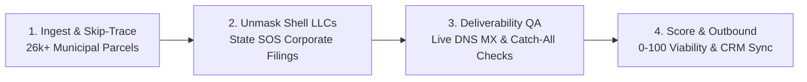

# Autonomous GTM Enrichment Engine

An autonomous, headless revenue operations pipeline that turns raw municipal property tax rolls into verified, high-converting B2B outbound campaigns.

---

## ⚡ The 4-Step Pipeline



---

## 🎯 How It Works (Step-by-Step)

### Step 1: Ingest & Skip-Trace (26,000+ Parcels)
- Ingests raw municipal deed filings, zoning codes, and property tax rolls across 17 towns.
- Standardizes addresses and clusters multiple properties sharing identical tax-bill mailing footprints into a single parent portfolio.

### Step 2: Unmask Shell LLCs (Secretary of State)
- Strips legal noise (`LLC`, `Holdings`, `Enterprises`) to identify parent operating entities.
- Queries State Secretary of State (SOS) corporate registries to extract the real human decision-makers: **Managing Members and General Partners** with legal signing authority.

### Step 3: MX Record & Deliverability Verification
- Runs live DNS MX checks and detects catch-all mail server configurations.
- Enforces strict deliverability gates before any email is dispatched to protect domain reputation and prevent bounces.

### Step 4: Viability Scoring & Precision Outbound
- Deterministic 0–100 scoring based on building square footage (e.g. 20,000+ sq ft) and commercial zoning (Industrial / Flex / Warehouse).
- Dispatches narrow, hyper-personalized sequences to verified principals:
  - **18% peak reply rate** in October
  - **10,000+ emails sent**
  - **~14 emails per meeting booked**

---

## 🚀 Quickstart & Demo

### 1. Run the Core Resolution Pipeline
```bash
python engine.py
```

### 2. Query the Apollo.io MCP / CLI Integration
```bash
# Live Organization Enrichment
node apollo_search.js --company "apollo.io"

# Interactive Demo Mode
node apollo_search.js --demo
```

---

## 🛡️ License
MIT License. Built by [Brent Maurice](https://bdrealestate.me).
