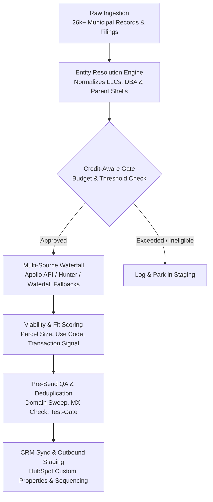

# Autonomous GTM Enrichment & Account Resolution Engine

An autonomous, headless revenue operations pipeline that ingests raw business entity and municipal tax records, resolves corporate ownership hierarchies (holding companies, shell entities, and operating locations), executes credit-aware multi-provider enrichment waterfalls, and outputs signal-scored accounts directly into CRM pipelines without manual intervention.

---

## 🏗️ Architecture



---

## ⚡ Core Capabilities

1. **Headless Ingestion & Normalization**: Automatically standardizes noisy entity names, strips legal suffixes (`LLC`, `INC`, `CORP`, `HOLDINGS`), and matches fragmented tax mailing addresses to resolve true beneficial ownership across multiple physical locations.
2. **Credit-Gated Multi-Source Waterfalls**: Queries primary API sources (Apollo / custom scrapers) with automated fallback to secondary enrichment providers. Implements strict monthly credit caps and per-record spend limits to eliminate runaway API costs.
3. **Deterministic Viability Scoring**: Dynamically calculates fit scores (0–100) based on firmographic footprint, zoning classification, and operational velocity signals.
4. **Pre-Send QA & Deliverability Protection**: Verifies mailbox MX records, detects spam-trap syntax, flags roll-up domain overlaps, and gates outreach behind automated test verification before syncing to downstream sequence engines.

---

## 🚀 Quickstart

### Prerequisites
- Python 3.10+
- `pip install -r requirements.txt`

### Execution
Run the headless enrichment pipeline:
```bash
python engine.py --input data/raw_accounts.csv --output data/enriched_accounts.csv --score-threshold 75
```

---

## 🛡️ License
MIT License. Built by [Brent Maurice](https://bdrealestate.me).
