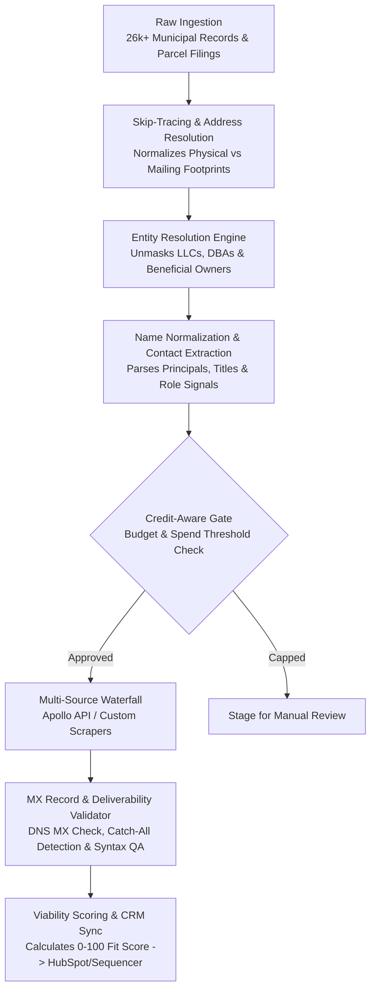

# Autonomous GTM Enrichment & Account Resolution Engine

An autonomous, headless revenue operations pipeline that ingests raw business entity and municipal tax records, executes address skip-tracing, resolves beneficial ownership across nested LLCs, validates name syntax and MX deliverability records, and executes credit-aware multi-provider enrichment waterfalls (Apollo.io + custom scrapers) without manual intervention.

---

## 🏗️ Architecture



---

## ⚡ Core Capabilities

1. **Skip-Tracing & Address Normalization**: Cross-references physical property parcel addresses with corporate mailing footprints, registered agent filings, and municipal tax rolls. Automatically standardizes USPS address formats and links multi-parcel portfolios to single operational hubs.
2. **Entity Resolution & Beneficial Ownership**: Strips noisy legal suffixes (`LLC`, `INC`, `CORP`, `HOLDINGS`, `PROPERTIES`), normalizes DBA records, and traces parent-subsidiary corporate trees to identify the true economic decision-maker.
3. **Name Parsing & Role Identification**: Cleans raw corporate registry filings into structured decision-maker profiles (First, Last, Title, C-Suite/Managing Principal flags), filtering out passive statutory agents and non-operating contacts.
4. **Credit-Gated Multi-Source Waterfalls (Apollo.io)**: Connects directly to Apollo.io's REST API and custom data scrapers. Enforces strict monthly credit quotas and per-account spend caps to eliminate runaway API costs during batch prospecting.
5. **MX Record & Deliverability Verification**: Executes live DNS MX record checks, detects catch-all mail server configurations, validates mailbox syntax permutations (`{first}.{last}`, `{first}`, `{f}{last}`), and gates dispatch behind deliverability verification to safeguard domain reputation.
6. **Deterministic Viability Scoring**: Dynamically scores accounts (0–100) based on asset scale, zoning classification, commercial use codes, and operational velocity signals before syncing downstream to CRM and sequencers.

---

## 🚀 Quickstart

### Prerequisites
- Python 3.10+
- `pip install -r requirements.txt`

### Execution
Run the headless enrichment pipeline:
```bash
python engine.py --input data/raw_accounts.csv --output data/enriched_accounts.csv --score-threshold 75
```

---

## 🛡️ License
MIT License. Built by [Brent Maurice](https://bdrealestate.me).
